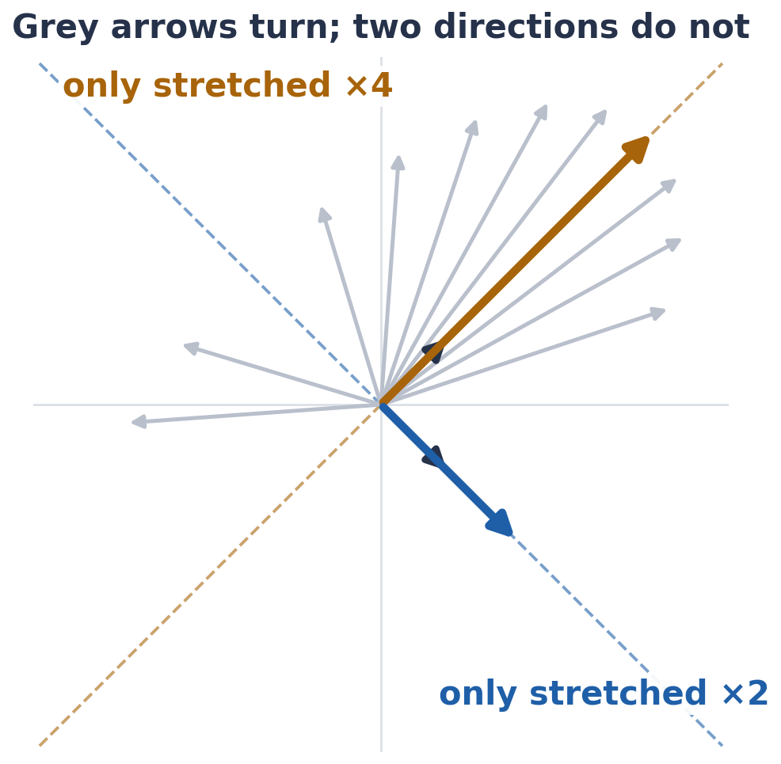

# Exercise 1 · Some directions only get longer

*≈ 15 min · lecture Part 1, slides 5 to 7*

## From the lecture

> **Key idea:** *A matrix stretches and turns arrows. Its eigenvectors are the special directions it only
> stretches; the stretch factor is the eigenvalue.*

> **The formula:** A v = λ v
>
> **In words:** matrix × special direction = stretch factor × the same direction
>
> **With numbers:** [[3, 1], [1, 3]] · (1, 1) = (4, 4) = 4 · (1, 1)

## What you are doing

**In one sentence:** you will push five arrows through a matrix and find the two that come out pointing the
same way they went in.



## Predict first

- **1a.** A = [[3, 1], [1, 3]]. Which of (1, 0), (0, 1), (1, 1), (1, −1), (2, 1) will come out pointing the
  same way, and by how much will each of those be stretched?

## Run

```python
ls.stretch_arrows()
ls.eigen_check()
```

## Look at

**Printout A** (the last column), then **Printout B**.

## Explain

- **1b.** Which arrows kept their direction, and what were their stretch factors? Was 1a right?
- **1c.** NumPy's eigenvectors have length 1, not (1, 1). Why is (0.707, 0.707) still the same eigenvector?
