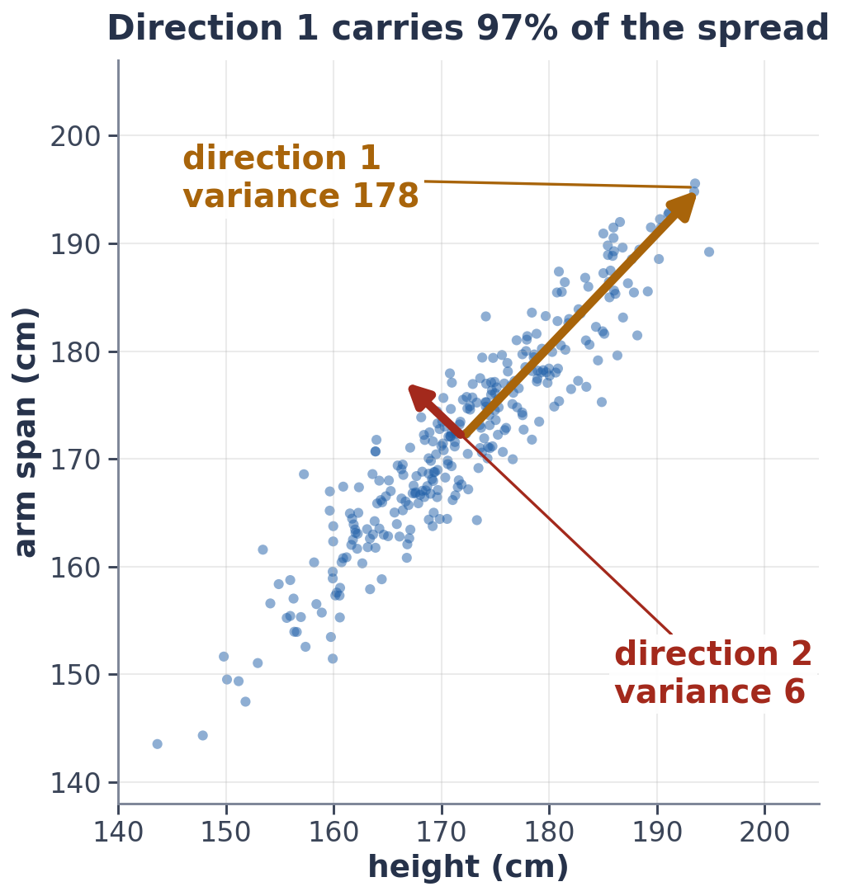

# Exercise 2 · Build PCA via SVD

*≈ 25 min · lecture Part 1, slides 8 to 11 · you build `my_pca`*

## From the lecture

> **Key idea:** *Centre the data, take its SVD (turn, stretch, turn). The biggest stretch is the direction the
> data spreads most: that is PCA.*

> **The formula:** X_c = U Σ Vᵀ, and the spread along direction k is σ_k² / (n − 1)
>
> **In words:** centred data = turn × stretch × turn; the biggest stretch is the main direction
>
> **With numbers:** height and arm span: 97% of the spread lies along one direction

## What you are doing

**In one sentence:** you will write PCA yourself in five lines, prove it matches scikit-learn, and use it to
find the main direction of a cloud of 300 people.



## Build: `my_pca`

| Step | In words | In code |
|---|---|---|
| 1 | centre: subtract each column's average | `X - X.mean(0)` |
| 2 | the SVD of the centred data | `np.linalg.svd(Xc, full_matrices=False)` |
| 3 | the top k directions | the first k rows of `Vt` |
| 4 | the spread along each direction | `S[:k] ** 2 / (n - 1)`, with n = `len(X)` |
| 5 | the data written in the new directions | `Xc @ components.T` |

```python
def my_pca(X, k):
    """PCA via the SVD. Returns (components, variance, scores)."""
    Xc = None                       # 1. centre
    U, S, Vt = None                 # 2. the SVD
    components = None               # 3. the top k directions
    variance = None                 # 4. the spread along each
    scores = None                   # 5. the data in the new directions
    return components, variance, scores

ls.check_my_pca(my_pca)
```

Run the check until every line shows ✓, then paste your five lines into **2a**. This is the same function
your capstone needs in `src/scratch/pca_svd.py`.

## Predict first

- **2b.** What share of the height-and-arm-span spread will lie along the main direction: about 50%, about
  75%, or over 90%?

## Run

```python
ls.height_span(my_pca)
```

## Look at

**Printout B**.

## Explain

- **2c.** Record Printout B. Why does one direction carry almost all of the spread, and what does direction
  1, about (0.69, 0.72), mean in plain words?
