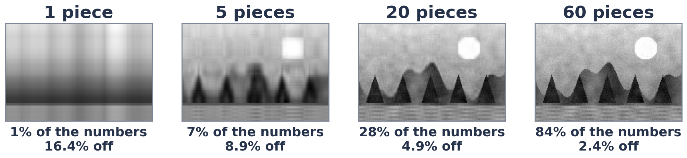

# Exercise 3 · Keep the big pieces

*≈ 15 min · lecture Part 1, slides 12 to 16*

## From the lecture

> **Key idea:** *The SVD splits any table of numbers into pieces, biggest first. Keeping only the big ones
> (a low-rank approximation) keeps almost everything for a fraction of the numbers.*

> **The formula:** A ≈ σ₁u₁v₁ᵀ + σ₂u₂v₂ᵀ + … + σ_k u_k v_kᵀ
>
> **In words:** picture ≈ biggest piece + next biggest piece + … (k pieces)

## What you are doing

**In one sentence:** you will shrink the lecture's photo to its biggest pieces and find how few you need.



## Predict first

- **3a.** The photo is 120 × 180 = 21,600 numbers. How many pieces before the error drops below 5%: about 5,
  about 20, or about 100?

## Run

```python
ls.shrink_photo()
```

## Look at

**Table A**.

## Explain

- **3b.** Record Table A. Was 3a right?
- **3c.** At k = 60 you store 84% of the numbers but the error is still 2.4%. Why do the last pieces matter so
  little? Connect this to LoRA in one sentence.

## Change one thing *(optional)*

- **3d.** Predict, then run `ls.shrink_photo((2, 3, 10))`. Which is the smallest k you would accept, and why?
