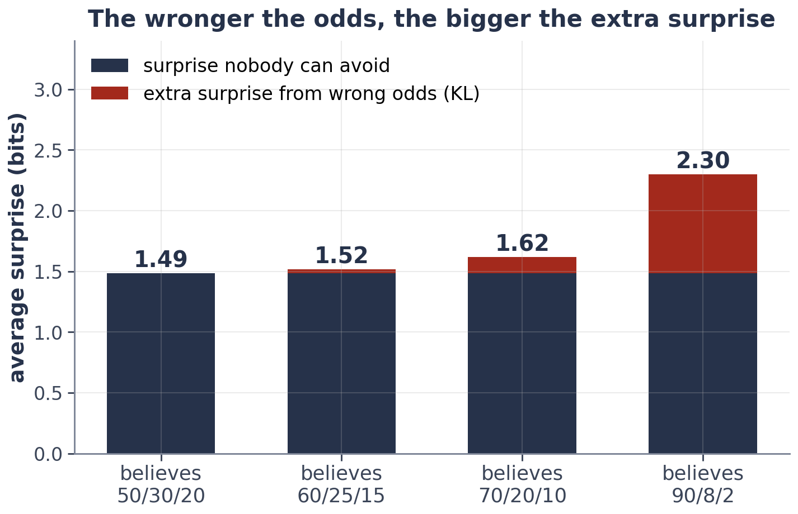

# Exercise 4 · Build entropy, cross-entropy and KL

*≈ 25 min · lecture Part 2, slides 17 to 25 · you build three functions*

## From the lecture

> **Key idea:** *Surprise is −log₂ p. Entropy is the average surprise; cross-entropy is the average surprise
> when you believe the wrong odds; KL is the extra surprise you pay for being wrong.*

> **The formulas:** H(p) = −Σ p log₂ p · H(p, q) = −Σ p log₂ q · KL = H(p, q) − H(p)
>
> **With numbers:** real odds 50/30/20, believed 70/20/10: 1.62 − 1.49 = 0.13 bits

## What you are doing

**In one sentence:** you will write the three formulas as one line each, check them, and use them on a
forecaster who believes the wrong odds.



## Run

```python
ls.surprise_table()
```

## Build: three one-line functions

`p` and `q` are NumPy arrays of probabilities. Use `np.log2` (bits). Paste your three lines into **4a** when
every line of the check shows ✓.

```python
def my_entropy(p):
    return None      # <- −Σ p log₂ p

def my_cross_entropy(p, q):
    return None      # <- −Σ p log₂ q

def my_kl(p, q):
    return None      # <- cross-entropy minus entropy

ls.check_my_information(my_entropy, my_cross_entropy, my_kl)
```

## Predict first

- **4b.** For the 70/20/10 forecaster, is KL closer to 0.01, 0.1 or 1 bit? And for one who believes 90/8/2?

## Run

```python
ls.weather(my_entropy, my_cross_entropy, my_kl)
```

## Look at

**Printout B**.

## Explain

- **4c.** Record the three numbers and the four KL values. Why is the first KL exactly zero, and why does it grow
  so fast at the end?
