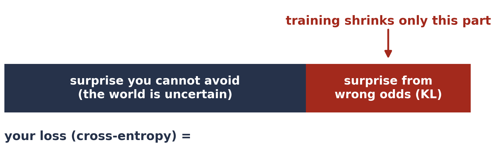

# Exercise 5 · A real model's loss is surprise

*≈ 15 min · lecture Part 2, slides 26 to 29*

## From the lecture

> **Key idea:** *The loss you trained with is the average surprise at the right answer. A model that knows
> nothing pays the entropy of the labels; whatever the features save on top of that is what they tell the model.*

## What you are doing

**In one sentence:** you will read the loss of Week 2's logistic regression on the credit data as surprise,
and measure how much the 23 features actually tell it.



## Predict first

- **5a.** Will the model's average surprise at the right answer be much lower than a model that only knows
  "22% of customers default", or only a little lower?

## Run

```python
ls.credit_surprise()
```

## Look at

**Table C**.

## Explain

- **5b.** Record Table C. Do the "by hand" number and scikit-learn's `log_loss` agree? Why?
- **5c.** The features save only about 0.08 bits per customer. Connect this to Week 2 (accuracy 0.81 against
  0.78 for saying "no default" to everyone).
