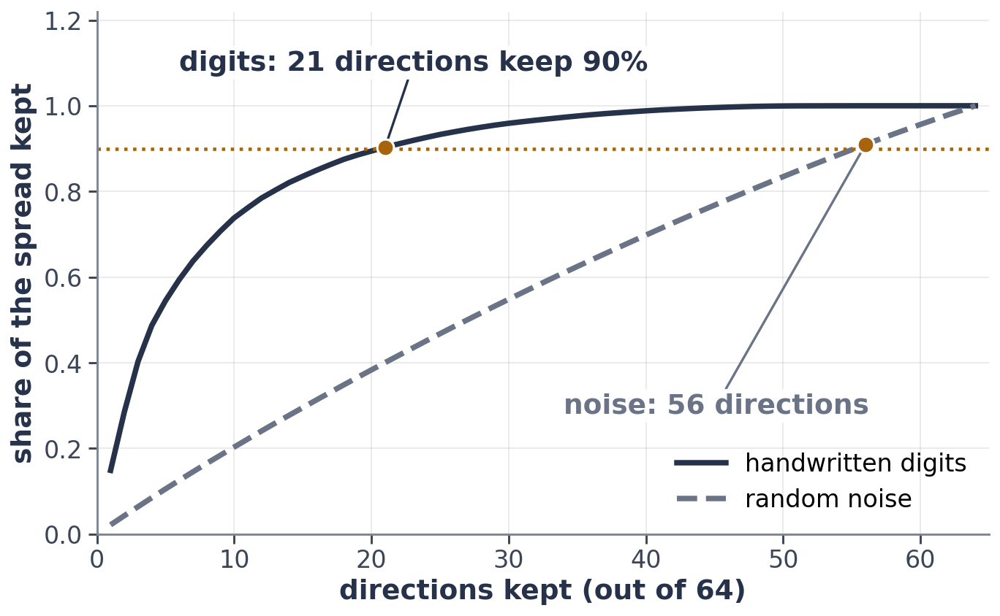

# Exercise 6 · Space: where does real data live?

*≈ 20 min · lecture Part 3, slides 31 to 37 · uses your own project data*

## From the lecture

> **Key idea:** *In many dimensions almost everything is near the edge and all distances look alike; but real
> data lives on a thin, low-dimensional sheet. Counting the directions that keep 90% of the spread gives a
> rough intrinsic dimension.*

> **The formula:** the smallest k with (σ₁² + … + σ_k²) / (σ₁² + … + σ_n²) ≥ 0.9
>
> **In words:** how many directions you need to keep 90% of the spread
>
> **With numbers:** handwritten digits: 21 of 64 · random noise: 56 of 64

## What you are doing

**In one sentence:** you will see the strange geometry of high dimensions, then use your own `my_pca` to count
the directions that matter in the digits and in **your own project data**.



## Predict first

- **6a.** In 100 dimensions, what share of an orange is peel (the outer 10%)? Below 50%, about 90%, or above 99%?
- **6c.** How many directions will keep 90% of the digits' spread? And for random noise of the same size?

## Run

```python
ls.orange_peel()
ls.distances()
ls.digits_and_noise(my_pca)
```

Then put the CSV of **your project dataset from Weeks 1 to 5** in the lab folder, give its name, and run:

```python
X_project = ls.load_project("my_data.csv")      # your file name; None uses the credit data
k = ls.count_directions(my_pca, X_project, "my project data")
```

## Look at

**Printouts A and B**, then **Tables C and D**.

## Explain

- **6b.** Why would "find the nearest neighbour" stop working well in 1,000 dimensions?
- **6d.** Record Tables C and D, and name your dataset.
- **6e.** What does your number tell you about *your* data, and what would you expect if you trained a model on
  just those directions?

## Two last questions

- **L1.** In one sentence each: what does the SVD find, what does KL measure, and what is an intrinsic dimension?
- **L2.** Which prediction today was furthest off, and what do you think now?
