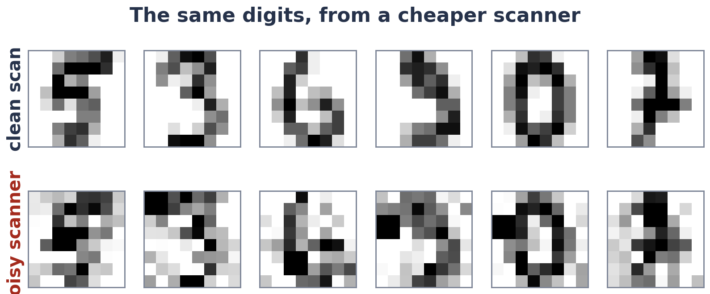

# Week 9 Lab: Adapt, Do Not Rebuild

> **You do not need the booklet for this lab.** Every question says which printout to read.

**The story.** A small network was trained on 900 clean scanned digits. It stands in for a pretrained model.
Your new job: digits from a cheap, **noisy scanner**, with only **5 labelled examples of each digit**. Do you
start again, or reuse what the network already knows?



The lab has **six exercises** that follow the lecture, and every exercise works the same way:

| Step | What you do | Where it goes |
|---|---|---|
| **Predict** | Commit to an answer *before* running the cell | `SUBMISSION.md` |
| **Run** | One cell, sometimes two | the notebook |
| **Look at** | The printout or table the page names | the notebook |
| **Explain** | Two or three sentences in your own words | `SUBMISSION.md` |
| **Build** *(Exercises 3, 4 and 5)* | One or two lines of code, checked by a `check_my_...` cell | the notebook, then `SUBMISSION.md` |

**A wrong prediction is not a mistake.** Write it before you run, and do not change it afterwards.

| Exercise | Lecture | Slides | You build | Time |
|---|---|---|---|---|
| 1 · Reuse it as it is | Parts 1 and 2 | 5 to 10, 13 | | 15 min |
| 2 · From scratch, or reused? | Part 1 | 5 and 6 | | 20 min |
| 3 · Adapt three ways | Part 2 | 12 to 22 | `my_lora_weight`, `my_lora_count` | 25 min |
| 4 · Augment, do not label | Part 3 | 24 to 28 | `my_augment` | 20 min |
| 5 · Count the cost | Part 4 | 30 to 33 | `my_energy_kwh`, `my_carbon_kg` | 15 min |
| 6 · Your capstone | Wrap-up | 35 | | 10 min |
| | Two last questions, then submit | | | 10 min |

About **2 hours**. **If any exercise takes you more than 40 minutes, stop and post in the channel.**

## What you need

- Python 3.10 or newer. **No PyTorch**: everything runs in NumPy in a few seconds, on any laptop. Or Google Colab.

```bash
pip install -r requirements.txt      # numpy, scikit-learn, matplotlib, notebook
jupyter notebook week9_lab.ipynb
```

## The files (you only open three)

| file | what it is | do I need it? |
|---|---|---|
| `week9_lab.ipynb` | **The lab.** Open this. | **yes** |
| `SUBMISSION.md` | **The answer sheet, blank.** Fill it in as you go. | **yes** |
| `WHERE_TO_FIND.md` | For each question, which cell to run and which printout to read. | **yes** |
| `lecture_steps.py` | The backbone, the noisy scanner, one helper per lecture idea, and the checks. | no |
