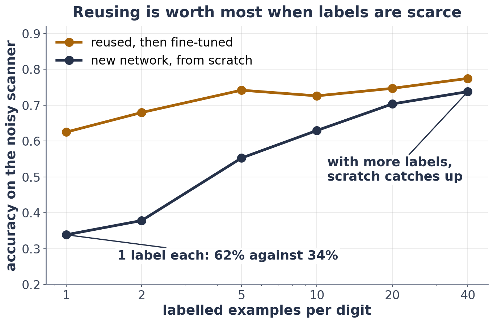

# Exercise 2 · From scratch, or reused?

*≈ 20 min · lecture Part 1, slides 5 and 6*

## From the lecture

> **Key idea:** *With few labels, reusing a pretrained model beats starting from scratch. With many labels,
> scratch catches up.*



## Predict first

- **2a.** With 5 labels per digit (50 in all), will a new network trained from scratch beat the reused backbone
  (with a new final layer), roughly tie, or lose?

## Run

```python
ls.scratch_or_reuse()
```

## Look at

**Printout B**.

## Explain, then predict

- **2b.** Record Printout B. Why does the network trained from scratch do so badly with 50 examples?
- **2c.** How many labels per digit does scratch need before it roughly catches up: about 5, about 20, or about 1,000?

## Run

```python
ls.labels_table()
```

## Explain

- **2d.** Record **Table C**. When is reusing worth most, and when does it matter least?
