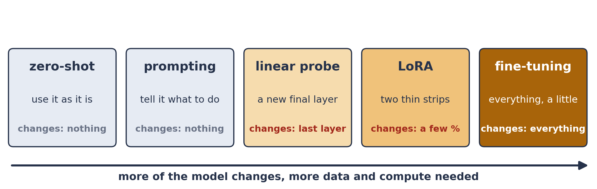
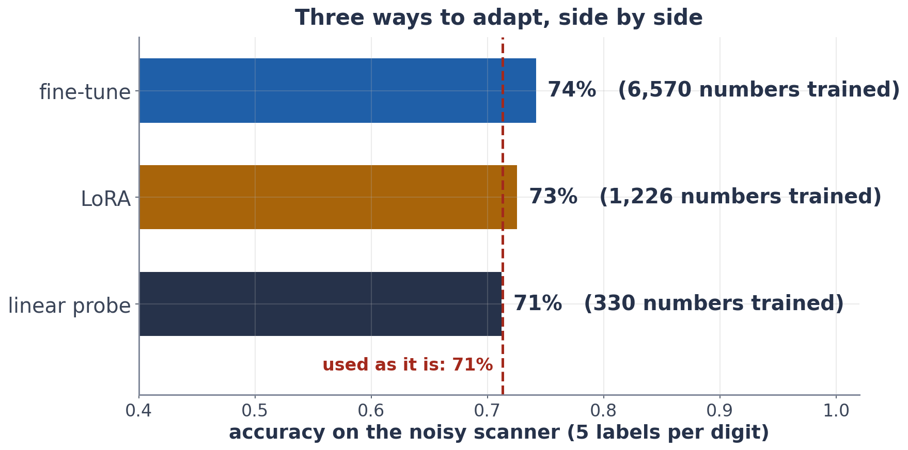

# Exercise 3 · Adapt three ways

*≈ 25 min · lecture Part 2, slides 12 to 22 · you build two lines*

## From the lecture

> **Key idea:** *The transfer spectrum: use it as it is; train only a new final layer (linear probe); train two thin
> strips added to each table (LoRA); or train everything a little (fine-tune).*



> **The formula (LoRA):** W′ = W + B A
>
> **In words:** new weights = old weights (frozen) + thin strip × thin strip
>
> **With numbers:** a 768 × 768 table at rank 8: 12,288 numbers to learn instead of 589,824

## Build: `my_lora_weight` and `my_lora_count`

```python
def my_lora_weight(W, B, A):
    return None      # <- the frozen table plus the low-rank change

def my_lora_count(d_in, d_out, r):
    return None      # <- the numbers in B plus the numbers in A

ls.check_my_lora(my_lora_weight, my_lora_count)
```

`B` is tall and thin (rows of W × r) and `A` is short and wide (r × columns of W). Paste your two lines into **3a**
when every line of the check shows ✓.

## Predict first

- **3b.** With 5 labels per digit, rank the three ways by accuracy, and by how many numbers they train.

## Run

```python
ls.three_ways()
```

## Look at

**Table D**.



## Explain

- **3c.** LoRA trains about a fifth of the numbers fine-tuning does. Is the accuracy worth the difference? Which would
  you choose for a model with a billion numbers, and why?
