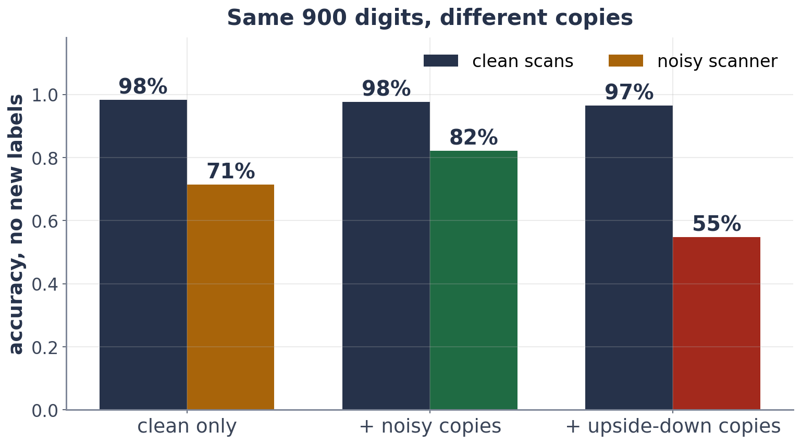

# Exercise 4 · Augment, do not label

*≈ 20 min · lecture Part 3, slides 24 to 28 · you build one line*

## From the lecture

> **Key idea:** *Augmentation adds copies that change the picture but not the answer. It teaches the model what does
> not matter (an invariance), without a single new label. The wrong copies teach the wrong lesson.*

> **The formula:** f(T(x)) = f(x)
>
> **In words:** the answer should not change when you apply the change T
>
> **With numbers:** T = add scanner noise: 71% → 82% on the noisy scanner, with no new labels

## Build: `my_augment`

Return the 900 clean digits **plus noisy copies of them**, and the labels repeated once for each copy.
`ls.noisy_copy(X, seed=...)` makes one noisy copy; use a different seed for each copy.

```python
def my_augment(X, y):
    copies = None      # <- a list: the originals, then some noisy copies
    return np.vstack(copies), np.tile(y, len(copies))

ls.check_my_augment(my_augment)
```

## Predict first

- **4b.** The backbone is trained again on your augmented copies (still no noisy-scanner labels). On the noisy scanner,
  will it beat 71%? And what will **upside-down** copies do?

## Run

```python
ls.augment_table()
ls.pretrain_with(my_augment, "+ noisy copies (yours)")
```

## Look at

**Table E**.



## Explain

- **4c.** What invariance did your noisy copies teach, and why do upside-down copies make things worse? (Hint: look at a 6.)
