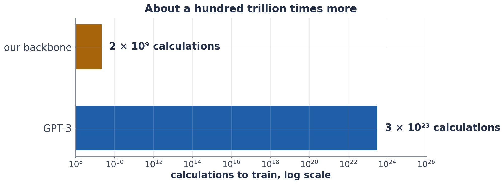

# Exercise 5 · Count the cost

*≈ 15 min · lecture Part 4, slides 30 to 33 · you build two lines*

## From the lecture

> **Key idea:** *Accuracy is not the only thing to choose by. Compute grows with numbers × data, and energy becomes carbon.*

> **The formulas:** energy (kWh) = power (W) × hours ÷ 1,000 · CO₂ (kg) = energy (kWh) × kg of CO₂ per kWh
>
> **With numbers:** 300 W for 10 hours = 3 kWh, about 0.9 kg of CO₂ at 0.3 kg per kWh

## Build

```python
def my_energy_kwh(watts, hours):
    return None

def my_carbon_kg(kwh, kg_per_kwh):
    return None

ls.check_my_carbon(my_energy_kwh, my_carbon_kg)
```

## Predict first

- **5b.** How many times more calculations did GPT-3's training need than our backbone's: about a thousand, a billion,
  or a hundred trillion?

## Run

```python
ls.cost_table(my_energy_kwh, my_carbon_kg)
```

## Look at

**Printout F**.



## Explain

- **5c.** Name two reasons, beyond accuracy, to prefer LoRA or a linear probe over full fine-tuning of a large model.
