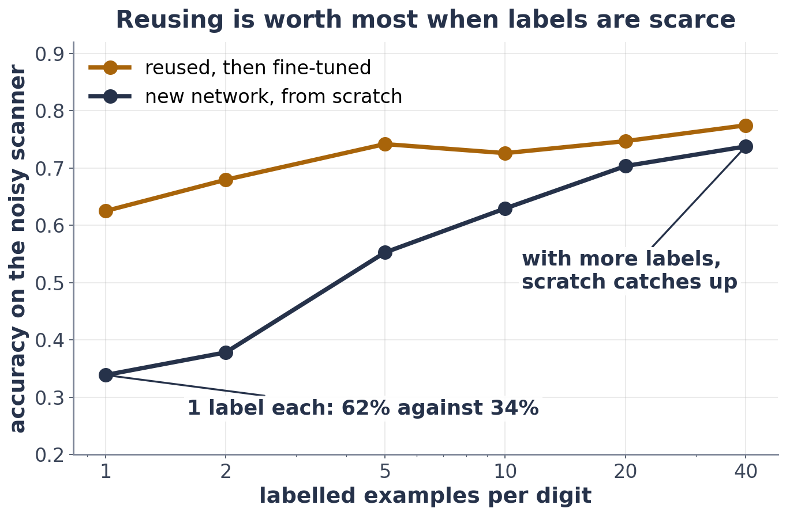

# Exercise 2 · From scratch, or reused?

**2a · prediction.** **It loses** (55.3% against 71.2%).
*The tempting answer:* the fresh network wins, because it can fit 50 examples perfectly. It does fit them; it just
learns those 50 pictures, noise and all, instead of what makes a 6 a 6.

**2b · record and explain.** From scratch **55.3%**; reused with a new final layer **71.2%**. With 50 examples and 6,570
numbers to set, the new network memorises. The reused backbone already knows strokes and shapes from 900 clean
digits, so it only has to learn a little.

**2c · prediction.** **About 20** (scratch reaches 70% at 20 per digit, still behind the reused model).

**2d · record and explain.**

| labels per digit | from scratch | reused + fine-tuned |
|---|---|---|
| 1 | 33.9% | 62.5% |
| 2 | 37.8% | 68.0% |
| 5 | 55.3% | 74.2% |
| 10 | 62.9% | 72.6% |
| 20 | 70.3% | 74.7% |
| 40 | 73.8% | 77.5% |

Reusing is worth most when labels are scarce (almost twice the accuracy at 1 label per digit) and matters less as
labels grow, because then scratch can learn the job by itself.
