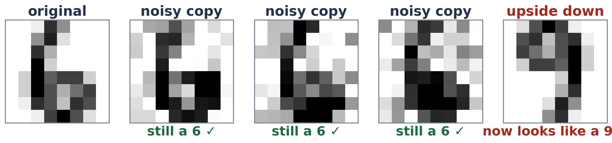

# Exercise 4 · Augment, do not label

**4a · build.**

```python
copies = [X, ls.noisy_copy(X, seed=11), ls.noisy_copy(X, seed=12), ls.noisy_copy(X, seed=13)]
```

**4b · prediction.** **Yes**: 82.2% on the noisy scanner. Upside-down copies make it **worse**: 54.8%.
*The tempting answer:* any extra copies help, because more data is always better.

**4c · record and explain.**

| trained on | clean | noisy scanner |
|---|---|---|
| clean digits only | 98.2% | 71.3% |
| + upside-down copies | 96.5% | 54.8% |
| + noisy copies | 97.7% | 82.2% |



Noisy copies with the same labels teach the invariance "noise and blots do not change the digit", which is exactly
what the new scanner needs: 11 points better, with no new labels. Upside-down copies teach "a digit upside down is the
same digit", which is false: an upside-down 6 is a 9. The model is told to give two different digits the same
answer, so it gets worse.
