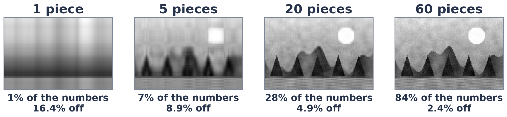

# Exercise 3 · Keep the big pieces

**3a · prediction.** **About 20.**
*The tempting answer:* about 100, because a photo looks complicated. Most of its structure (the sky gradient,
the hills, the lake) lives in a few big pieces.

**3b · record.** k = 1: 1% of the numbers, error 16.4% · k = 5: 7%, 8.9% · k = 20: 28%, 4.9% · k = 60: 84%, 2.4%.

**3c · explain.** The pieces come biggest first, so the last ones are tiny: they carry fine grain and noise.
LoRA bets on the same thing: the *change* a model needs during fine-tuning is mostly captured by a few
pieces, so two thin strips can stand in for a full table.

**3d · change (optional).** Your own judgement; around k = 10 to 20 is a common choice, where the trees and
the sun become clear.
