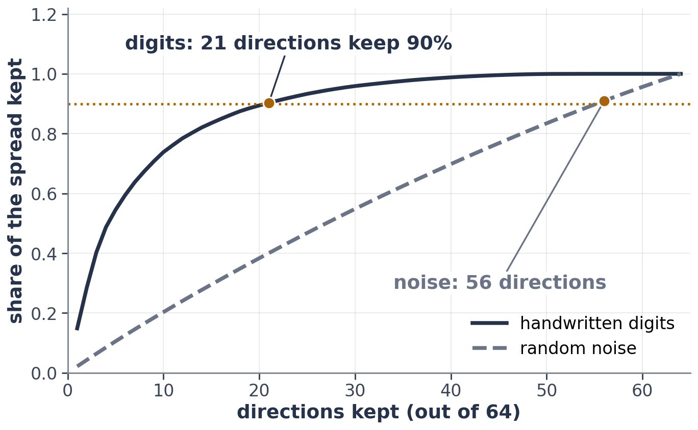

# Exercise 6 · Space: where does real data live?

**6a · prediction.** **Above 99%** (99.997%).
*The tempting answer:* about 10%, because the peel is 10% thick. Each dimension keeps only 90% of the fruit,
and 0.9 multiplied by itself 100 times is 0.00003.

**6b · record and explain.** Peel: 2-D 19%, 3-D 27.1%, 10-D 65.1%, 100-D 99.997%. Farthest ÷ nearest pair:
593×, 8.97×, 1.73×, 1.19×. When every point is about equally far from every other, "nearest" carries
almost no information, so nearest-neighbour methods and distance-based clustering lose their grip.

**6c · prediction.** Digits: **21** of 64; random noise: **56** of 64.

**6d · record.** Table C: digits 21 of 64, noise 56 of 64. Table D depends on your dataset; with the credit
data, **13 of 23**.

**6e · explain.** Your own answer, about your data. A small count means your columns move together: much of the
table is repeated information, and a model trained on just those directions would lose little. A count close to
the number of columns means each column carries something of its own.

**L1.** The SVD finds the directions a table of numbers stretches most, biggest first. KL measures the extra
surprise you pay for believing the wrong odds. An intrinsic dimension is how many directions the data really
needs, however many numbers it is written in.

**L2.** Your own answer. The most common: 1a, 3a or 6a.
