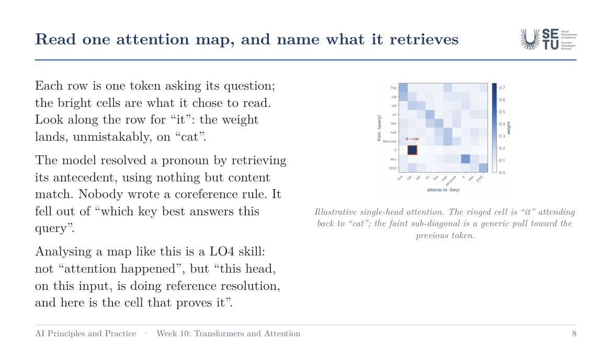

# Section 1 · Attention from a real model

*≈ 11 min · lecture Sections 1 and 2 · slides 6 to 8, 12, 39 and 40 · booklet Sections 2, 4 and 16.1 to 16.3*

## What you'll learn

Attention is a soft lookup: each token asks a question (its **query**), every token advertises what it offers (its
**key**), and the result is a blend of what the tokens carry (their **values**), weighted by how well each key
matched. The booklet builds that in NumPy by hand; here you read the identical operation off DistilBERT.

## 1.1 · Run a model and find the attention

Run cell **1.1**: it loads DistilBERT asking for its attention, runs a headline through it, and prints the shapes.

- **1a.** The attention tensor is `(1, 12, seq, seq)` at each of six layers. Say in one phrase what each of the `12`
  and the two `seq` dimensions is.

## 1.2 · Read one head

Run cell **1.2**: it plots a single head. Do **not** average all twelve; that blurs twelve different jobs into mush.

- **1b.** Every row sums to one, because each token spends a fixed budget of attention across the sequence. Describe in
  one sentence what this head (layer 3, head 4) seems to do. Then change `layer` and `head`, find one that behaves
  visibly differently, and note it. You want a claim you could defend, not a decoration.

## 1.3 · Stress-test your claim

An observation on one input is not a finding (slide 40). Run cell **1.3** with **your** head, after editing its two
sentences: one where your claim predicts the same pattern, and one where it should **break**.

- **1c.** State your claim in one sentence. Did the pattern hold where it should, and break where it should? A head that
  behaves identically on an input where your claim predicts something different has falsified your claim.

> **Real maps are messier than the lecture's.** The booklet's figures are built to show one mechanism cleanly. Real
> heads smear weight across several tokens and park a surprising amount on `[CLS]`, `[SEP]` and full stops. That gap
> is part of the lesson, not a sign that your code is wrong.

## Checkpoint 1

- **1d.** What do the query, key and value each contribute, in one phrase each?
- **1e.** Why must every row of an attention matrix sum to one, and what does that force to be true?
