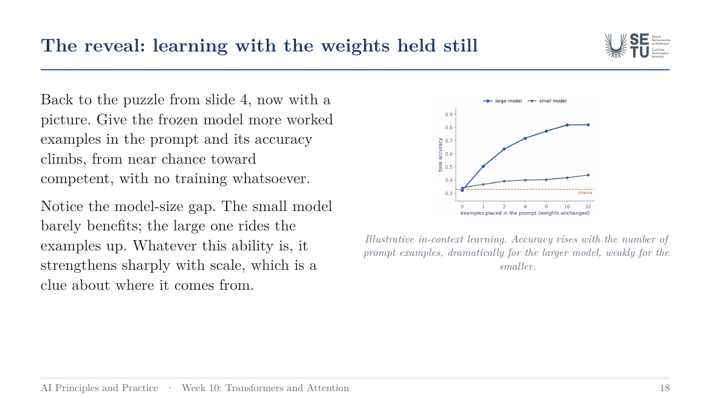

# Section 2 · In-context learning, with the weights frozen

*≈ 12 min · lecture Section 3 · slides 4, 17 to 20 and 42 · booklet Sections 8, 9 and 16.5*

## What you'll learn

This is the strange one, and the spine of the week. You give a frozen model a few worked examples inside its prompt
and watch it do better, with no training and no weight change. You will also see a small model do it only modestly,
which is exactly what the lecture's scaling story predicts.

## 2.1 · Score a label with no examples (zero-shot)

Run cell **2.1**. It classifies a headline by scoring each label's log-probability under the frozen GPT-2, and takes
the highest.

- **2a.** No example was given, yet the model produces a category. If not from this prompt, where could any ability to
  do the task at all have come from?

> **One change from the lecture notes.** GPT-2 is asked to choose between *World*, *Sports*, *Business* and
> *Technology*, so the notebook marks its answers against those same four names (`ICL_NAME`). An earlier version
> marked them against *Sci/Tech*, which the model can never say, and so scored every Sci/Tech headline as wrong.

## 2.2 · Add examples and measure the lift

Run cell **2.2**. It builds a few-shot prompt and measures accuracy as the number of examples grows. The evaluation is
deliberately small (60 headlines) so it runs in a minute.

- **2b.** Record your curve. The lift is usually real but modest, and a little noisy. That is not a bug: `gpt2` is a
  *small* model, and the lecture's figure showed the small model barely benefiting while the large one climbed. You
  are looking at the bottom curve of that figure, run with your own hands. In two sentences, state what changed
  between the runs to move the accuracy (the weights did not), and why it is still fair to call this "learning".

## 2.3 · How much of that is luck?

One draw of examples is noisy, and a single draw will tempt you to over-read the curve (booklet Section 16.5). Run cell
**2.3**: it repeats 2 and 4 shots with three different draws of examples. Two or three minutes.

- **2c.** Record the mean and the spread. How does the spread compare with the lift from 0 to 4 shots, and what does
  that say about a curve made from one draw?

## Checkpoint 2

- **2d.** What is held completely fixed during in-context learning, and what does that rule out as an explanation?
- **2e.** Your lift was modest. Give the lecture-consistent reason, in terms of model size.
