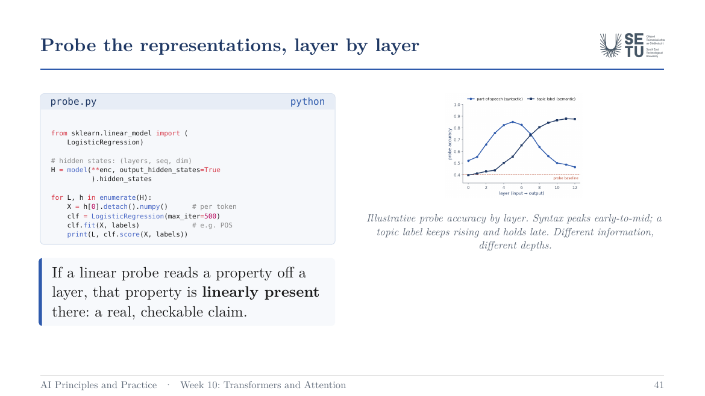
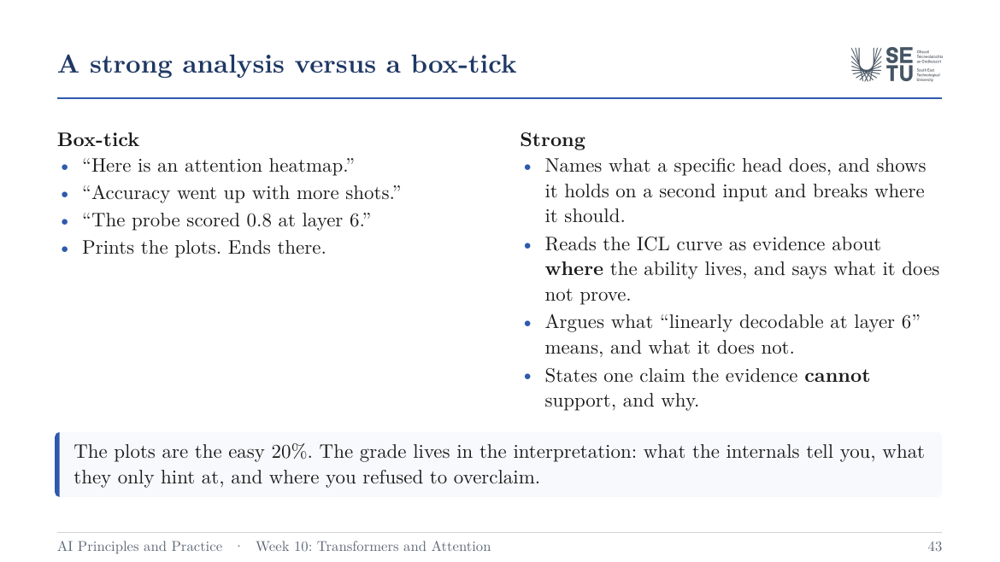

# Section 3 · Inside the transformer, probed against a baseline

*≈ 13 min · lecture Sections 4 and 6 · slides 25 to 29, 41 and 43 · booklet Sections 12, 15 and 16.4 · the LO4 core*

## What you'll learn

If a simple linear classifier can read a property off a hidden layer, that property is *linearly present* there. That
is a precise, checkable claim, and interpreting it without overclaiming is the LO4 skill of the week. First you need
an honest opponent to measure against.

## 3.1 · The baseline to beat

Run cell **3.1**: a plain TF-IDF linear model. Old technology, and a serious opponent.

- **3a.** Record the accuracy. It should be about **0.924**.

A model with no attention, no pretraining and no GPU, trained in a few seconds, gets more than nine headlines in ten
right, because topic is mostly signalled by *which words are present*. Hold that number.

## 3.2 · Probe the layers

Run cell **3.2**. It takes the `[CLS]` vector at three layers, trains a linear probe on each, and compares them.
Layer 0 is the embedding, before any attention, so it is a genuine baseline. About a minute on a laptop.

- **3b.** Record the three numbers: all should clear the 0.25 chance line, and topic is usually more decodable late
  than at layer 0. Now the honest twist: compare your best layer with the 0.924 baseline. A frozen, un-fine-tuned
  encoder read at `[CLS]` often *loses* to bag-of-words, and that is the real result, not a disappointment. Write two
  sentences on what your curve shows, and be precise about what a successful probe does *not* prove: that the property
  is decodable is not that the model uses it, nor that it is there for that purpose. That restraint is LO4.

> **Strong versus box-tick (slide 43).** "The probe scored 0.8 at layer 6" is a box-tick. A strong answer argues what
> "linearly decodable at layer 6" means, and what it does not.

## Checkpoint 3

- **3c.** Why is layer 0 a useful baseline, and why keep the probe a plain linear model?
- **3d.** State the precise claim a successful probe licenses, and one claim it does not.
