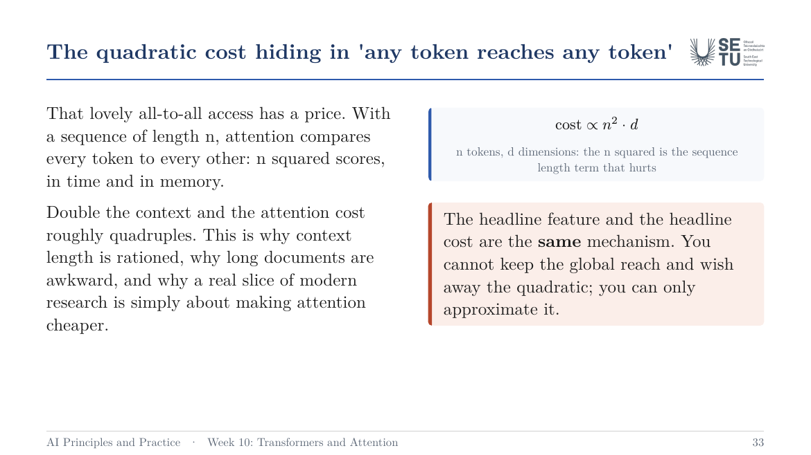

# Section 4 · The bill, and a caveat

*≈ 9 min · lecture Section 5 · slides 33 to 36 · booklet Sections 13, 14 and 15*

## What you'll learn

Attention lets any token reach any other in one step, and that reach is also its cost: it compares every token with
every other, quadratically. You will measure that, then name a failure mode no accuracy number shows.

## 4.1 · Measure the quadratic cost

Run cell **4.1**. It builds the score matrix at growing lengths and reports the memory. No model needed: the cost is
in the shape.

The memory quadruples every time `n` doubles: about 0.26, 1.05, 4.19, 16.78 and 67.11 MB for one `float32` score
matrix on its own. Multiply by heads and layers, keep it for the backward pass, and you see why context length is
expensive.

- **4a.** What would you have to give up to make attention cheaper than quadratic?

## 4.2 · A caveat worth a sentence

Two quick points, no new code.

First, **prompt brittleness**: your Section 2 classifier can change its answer when you reword a prompt that means the
same thing, which is why evaluating on a single fixed phrasing flatters a model. Second, **"attention is not
explanation"**: you can often change an attention map and get the same output, and two-thirds of a transformer's
parameters live in feed-forward layers that no heatmap shows.

- **4b.** Write one sentence you would say to a manager who points at a pretty attention picture and calls it the
  model's reasoning.

## Checkpoint 4

- **4c.** Doubling the sequence length multiplied attention memory by how much, and why that factor?
- **4d.** Name one failure mode a single accuracy number on a fixed test set would hide.
