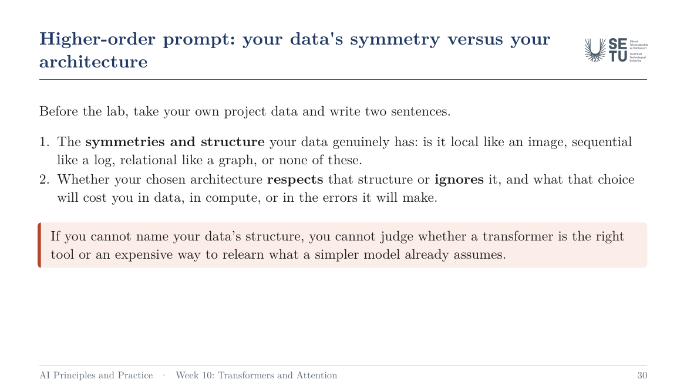

# Section 5 · Your capstone

*After the lab, in your own time · slides 30 and 44 · booklet Sections 12.4 and 16.6*



Before anything else, answer **5a** in `SUBMISSION.md`: two sentences on the structure your capstone data genuinely
has, and whether your chosen model respects it. If you cannot name your data's structure, you cannot judge whether a
transformer is the right tool, or an expensive way to relearn what a simpler model already assumes.

## Where this week fits your elective

- **E3 · Route A (transformers for text)** uses this week directly: the brief asks you to *show where it pays attention,
  and test what each layer has learned*, and to prepare for the interview question *what is one attention head looking
  at, and does that explain the decision?* Sections 1 and 3 of this lab, taken to your own messages, are that work in
  miniature.
- **E4 · Transfer learning for buying a house** reuses pretrained image and text models. Probing a layer (5.2) works on
  their numbers too, and a vision transformer's attention can show which parts of a photo it reads.
- **E1, E2, E5 and E6** have tables or equations, not long sequences. For tabular data, gradient-boosted trees remain
  very strong, and a transformer is often the slower and worse choice (booklet Section 12.4). Use **5a** to say why,
  in two sentences: that is a good answer, not a gap.

## The three exercises, on your own data

They are deliberately unfinished. The notebook has a cell for each.

```python
# exercise_10_1.py: extract and name a head on your data
# - load a pretrained transformer suited to your data (text, or a vision transformer)
# - run one example with output_attentions=True, pick ONE head, visualise it
# - write a one-sentence claim about its job, then test it on an example that should break it
```

```python
# exercise_10_2.py: probe your model's layers
# - take a labelled sample; extract a fixed representation at several layers
# - train a linear probe per layer, plot accuracy vs layer against the RIGHT chance baseline
# - say where the property becomes decodable, and what that does NOT prove
```

```python
# exercise_10_3.py: in-context learning on your task
# - build a few-shot prompt with the weights frozen
# - measure accuracy vs number of shots, averaged over several random example draws
# - interpret the size of the lift in terms of the model's scale
```

- **5b.** Which of these will you do on your own data, and why that one? If none fits your elective, say why a
  transformer is not the right tool for your data.

## The leap this lab does not make for you

- The lab hands you a model and clean data; your project makes you *choose* a suitable pretrained model for *your*
  data and justify it, including whether a transformer is even the right tool.
- The lab names a head to start from; your project asks you to find one worth discussing and defend the claim against
  an input that should break it.
- The lab measures a probe against a fixed baseline; your project asks you to pick the right baseline for your classes
  and interpret the result, high or low, without overclaiming what "decodable" means.

Labs demonstrate a single modern method; your elective asks you to choose, justify and integrate methods into your own
build, and to defend them in your ten-minute interview. Keep your named head, your probe numbers and your in-context
curve: they can become sections of your report.

**Next week** adapts a pretrained backbone by fine-tuning and LoRA, which is where the frozen transformer that lost to
TF-IDF here finally overtakes it. Today's baseline is the number adaptation has to beat.
