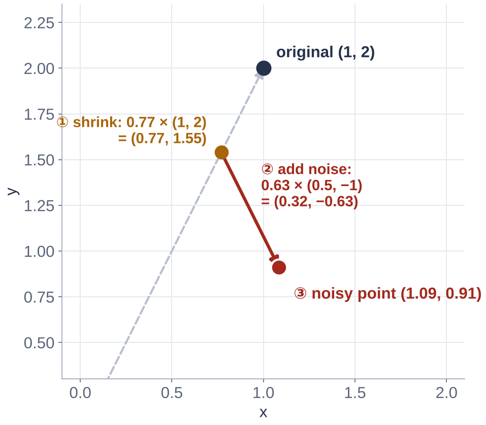
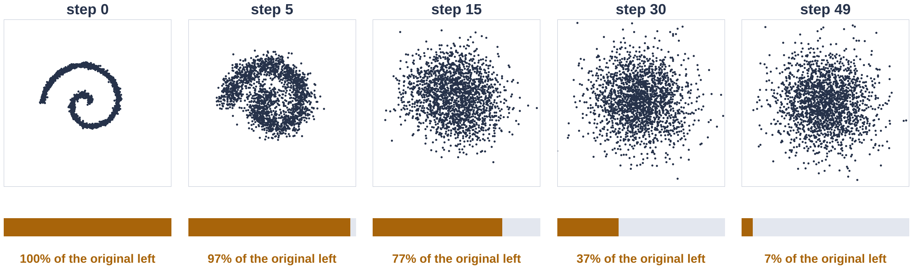

# Exercise 1 · Add noise, step by step

*≈ 15 min · lecture Part 1, slides 8 to 12 and 17 · you build one line*

## From the lecture

> **Key idea:** *Like ink spreading in water, a diffusion model dissolves data into noise in many small steps. After step
> t, a share √ᾱ of the original is left, mixed with noise.*

> **The formula:** x_t = √ᾱ_t · x₀ + √(1 − ᾱ_t) · ε
>
> **In words:** noisy point = a shrinking share of the original + a growing share of random noise
>
> **With numbers:** step 15: 77% of the original is left · step 49: only 7%


## In plain words

Every dot is pulled a little towards the middle (**× a**) and then given a random push (**+ b × noise**). Your line is exactly those two moves. Worked example at step 15, where a = 0.77 and b = 0.63: the dot (1, 2) with noise (0.5, −1) becomes 0.77 × (1, 2) + 0.63 × (0.5, −1) = **(1.09, 0.91)**. In the code, a is `np.sqrt(abar_t)` and b is `np.sqrt(1 - abar_t)`.



## Build: `my_noisy`

```python
def my_noisy(x0, eps, abar_t):
    return None      # <- replace None with your one line

ls.check_my_noisy(my_noisy)
```

Paste your line into **1a** when every line of the check shows ✓.

## Predict first

- **1b.** The schedule has 50 steps. At which step will the spiral stop being recognisable: around step 5, 15, 30 or 49?

## Run

```python
ls.forward_steps(my_noisy)
```

## Look at

**Printout A**.



## Explain

- **1c.** Was 1b right? Why does the average distance to the spiral stop growing near the end?
