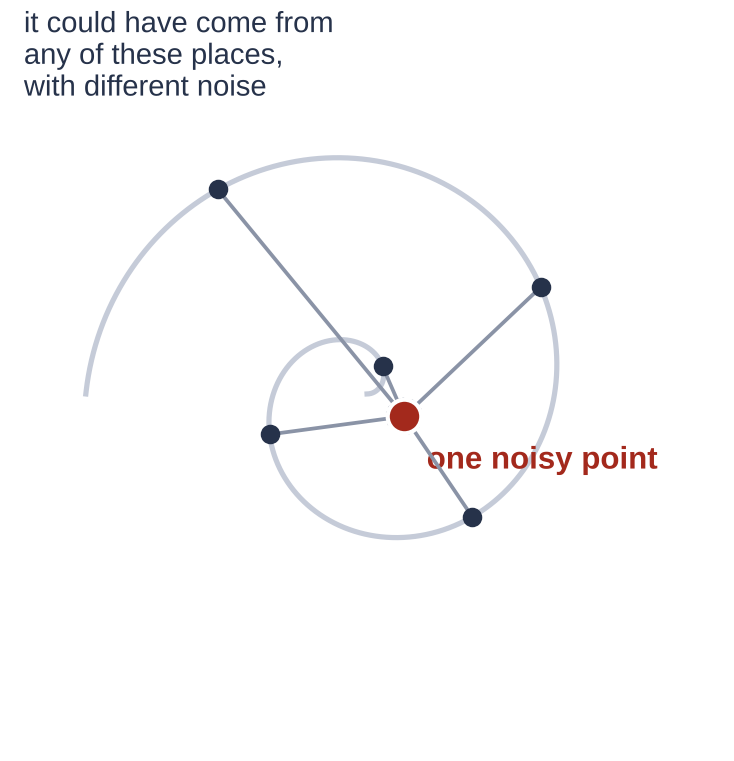
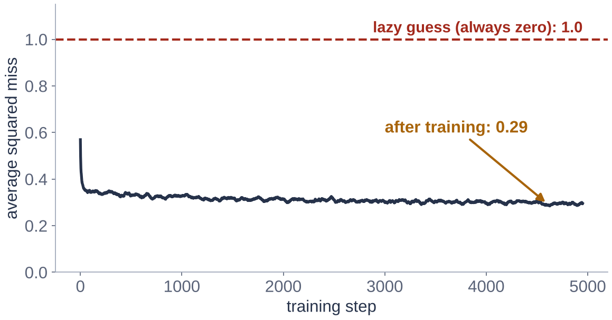

# Exercise 2 · Learn to undo it

*≈ 20 min · lecture Part 1, slides 13 to 17 · you build one line*

## From the lecture

> **Key idea:** *A small network looks at a noisy point and the step number and guesses the noise that was added. It is
> trained by the squared miss between the real noise and its guess.*

> **The formula:** L = average of (ε − ε̂)²
>
> **In words:** loss = the average squared miss between the real noise and the guess
>
> **With numbers:** guessing zero every time: 1.0 · after training: about 0.3


## In plain words

The network plays a guessing game: we add noise that we chose, and it guesses what we added. Because we chose the noise, we always know the right answer, so no labels are needed. Your line scores a guess: **square each miss, then take the average**. The check uses misses of 1, 0, 0 and 2: squared 1, 0, 0, 4, average (1 + 0 + 0 + 4) ÷ 4 = **1.25**. The miss can never reach 0, because one noisy dot could have come from many places.



## Build: `my_loss`

```python
def my_loss(eps, guess):
    return None      # <- replace None with your one line

ls.check_my_loss(my_loss)
```

## Predict first

- **2b.** Guessing zero noise every time scores about 1.0. After training, will the miss be near 0, about 0.3, or still about 1.0?

## Run

```python
ls.train_denoiser(my_loss)      # about 10 seconds
```

## Look at

**Printout B**.



## Explain

- **2c.** Why can the miss never reach 0? (Hint: at the last steps, how much of the original is left?)
