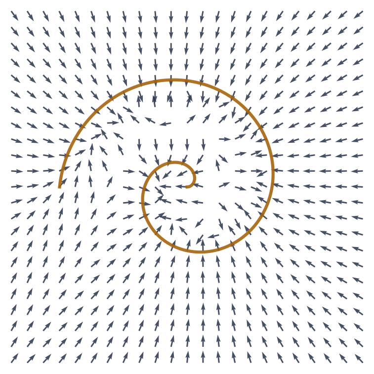
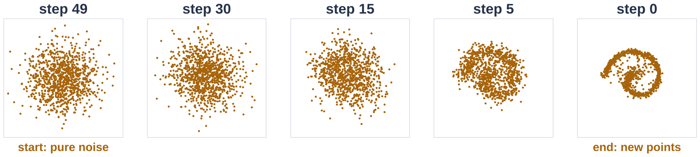

# Exercise 3 · Generate from pure noise

*≈ 20 min · lecture Part 1, slides 18 to 22*

## From the lecture

> **Key idea:** *Start from pure noise and run the steps backwards: at each step, remove a little of the guessed noise
> and add a little fresh noise. The points walk onto the data's sheet: the learned manifold.*


## In plain words

Start from random dots and run the 50 steps backwards. Each step has three moves: **ask** the network what noise it sees, **remove** a little of it, and **shake** in a little fresh noise so the new dots stay varied. Then two checks: are the new dots on the spiral, and are any of them copies of training dots?



## Predict first

- **3a.** Pure noise sits about 0.42 from the spiral on average, and real points about 0.03. Where will your generated
  points land?

## Run

```python
ls.generate()
ls.inspect_samples()
```

## Look at

The pictures, then **Tables C and D**.



## Explain

- **3b.** Record Tables C and D. Did the generated points land on the spiral? Are they new points or copies?
- **3c.** Why does it matter whether a generative model makes new points or copies of its training data? (Think of a model
  trained on private photos or medical records.)
