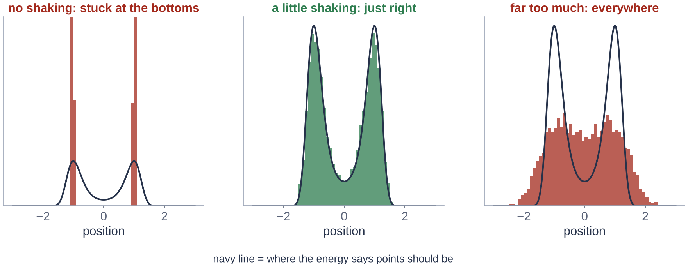
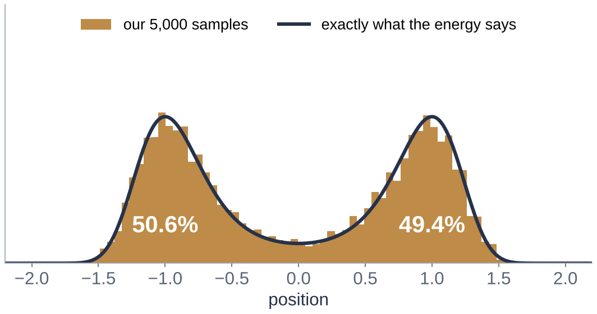

# Exercise 4 · Roll downhill, with a little shaking

*≈ 15 min · lecture Part 4, slides 50 to 52 · you build one line*

## From the lecture

> **Key idea:** *An energy-based model says low energy = likely. To draw samples, roll downhill on the energy, with a
> little random shaking so you do not just stop at the bottom.*

> **The formula:** x ← x − step · slope + √(2 · step) · z
>
> **In words:** new position = old − a small step downhill + a little random shake


## In plain words

A marble on a landscape with two valleys. Each step: roll a little **downhill** (take away step × slope) and give a little random **shake** (add √(2 × step) × z). The check: from 1.5, slope 10, step 0.01, shake 1 → 1.5 − 0.1 + 0.14 = **1.54**. With no shaking, every point stops at a valley bottom; with a little, they spread exactly as the energy says.



## Build: `my_langevin_step`

```python
def my_langevin_step(x, slope, step, z):
    return None      # <- replace None with your one line

ls.check_my_langevin(my_langevin_step)
```

## Predict first

- **4b.** The energy has two equally deep valleys, at −1 and +1. 5,000 points start spread from −3 to 3. After 500 steps,
  roughly what share will be in each valley?

## Run

```python
ls.langevin(my_langevin_step)
```

## Look at

**Printout E**.



## Explain

- **4c.** What would happen without the shaking (z = 0)? And with far too much shaking?
