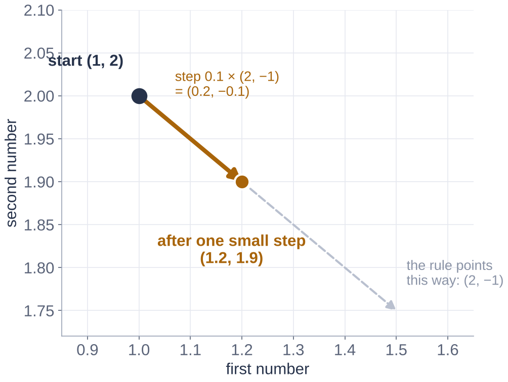
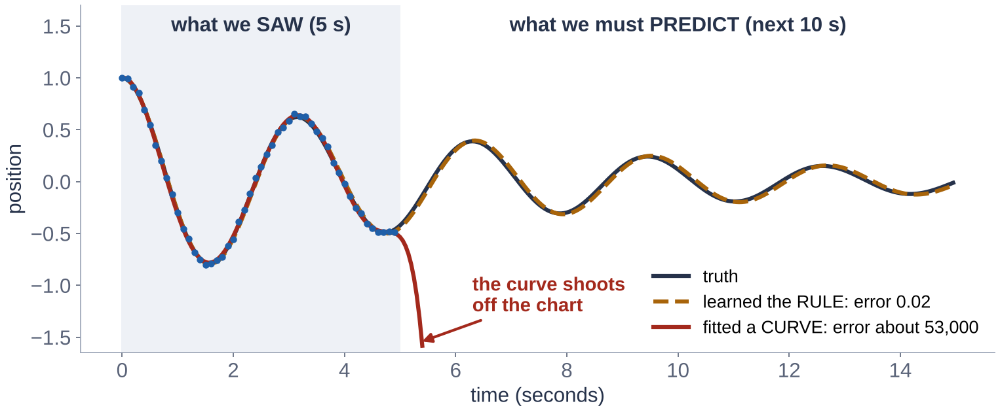
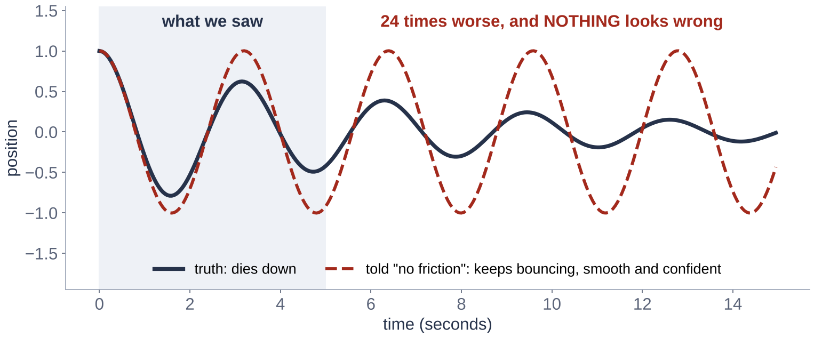

# Exercise 5 · Layers as steps; learn the rule of motion

*≈ 20 min · lecture Part 2, slides 24 to 32, and slide 60 · you build one line, then change one thing*

## From the lecture

> **Key idea:** *A residual layer is one small step along a flow: h + Δt · f(h). Many small steps follow a smooth path. A
> neural ODE learns the rule of motion f itself, and a learned rule can predict beyond the data.*

> **The formula:** h_{k+1} = h_k + Δt · f(h_k)
>
> **In words:** next state = this state + a small step in the direction the rule points


## In plain words

One small step = **where you are + step size × the arrow**. That is also exactly one residual layer, h + f(h). The check: from (1, 2), the arrow is (2, −1) and the step is 0.1, so you land at (1 + 0.2, 2 − 0.1) = **(1.2, 1.9)**. Then you compare learning the *rule* with fitting a *curve*, and see what a slightly wrong rule does.



## Build: `my_euler_step`

```python
def my_euler_step(h, f, dt):
    return None      # <- replace None with your one line

ls.check_my_euler(my_euler_step)
```

## Predict first

- **5b.** Following a bouncing spring for 5 seconds: with 20 big steps or 500 small ones, which ends closer to the truth,
  and by roughly how much?
- **5c.** You observe the spring for 5 seconds. One method learns the *rule of motion*; another fits a smooth *curve* through
  the same points. Which predicts the next 10 seconds better?

## Run

```python
ls.layers_as_steps(my_euler_step)
ls.learn_rule()
```

## Look at

**Printout F**, then **Table G**.



## Explain

- **5d.** Why does learning the rule predict so much better than fitting the curve? Connect this to electives E5 and E6.

## Change one thing: a wrong rule

The model is now *told* the spring has no friction (the real one has a little), and learns only its stiffness.

- **5e.** Predict first: better or worse than the freely learned rule beyond 5 seconds, and by how much? Then run, look at
  **Printout G2**, and explain why a wrong rule is dangerous even though its predictions look smooth and confident.

```python
ls.wrong_rule()
```


