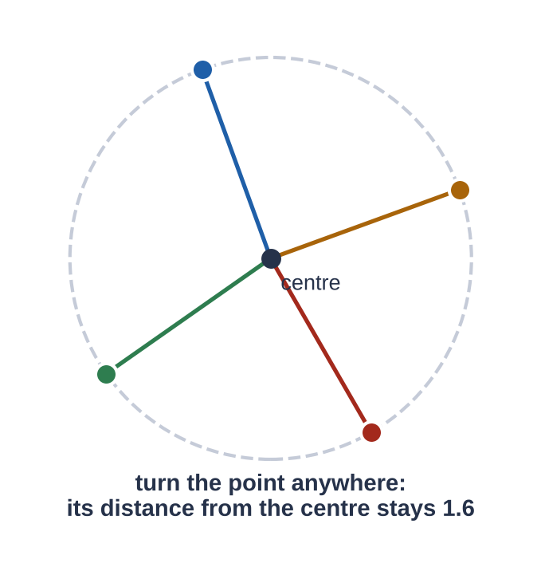
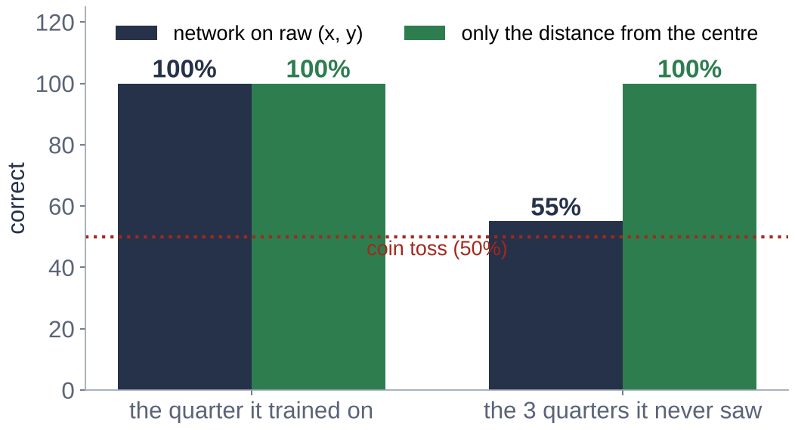
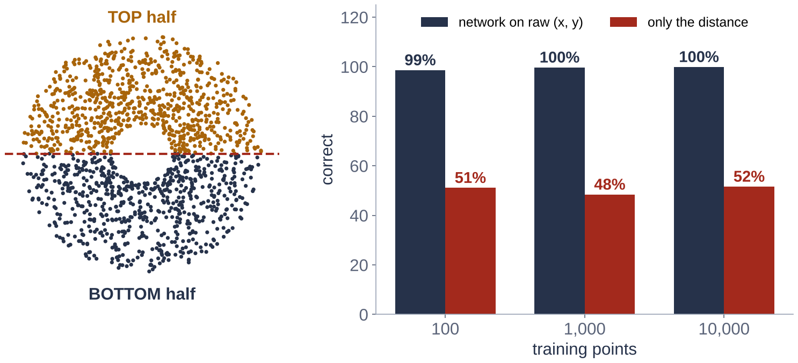

# Exercise 6 · Build the symmetry in

*≈ 20 min · lecture Part 4, slides 53 to 58, and slide 63 · you build one line, then change one thing*

## From the lecture

> **Key idea:** *If the answer should not change when you turn the picture (an invariance), build that into the model rather
> than hoping it learns it.*

> **The formula:** invariant: f(Rx) = f(x) · equivariant: f(Rx) = R f(x)


## In plain words

The distance from the centre is **√(x² + y²)**: Pythagoras. Turning a dot round the centre never changes it, so a model that only reads the distance cannot be fooled by turning. The check: (3, 4) → √(9 + 16) = **5**, and (0, −2) → **2**. In NumPy, `(X ** 2).sum(1)` adds x² + y² for every row.



## Build: `my_radius`

```python
def my_radius(X):
    return None      # <- each point's distance from the centre, √(x² + y²)

ls.check_my_radius(my_radius)
```

## Predict first

- **6b.** Inner ring or outer ring? Both models see only one quarter of the circle when training. On the other three
  quarters, will the network on raw (x, y) still do well? And the model that only sees the distance from the centre?

## Run

```python
ls.symmetry(my_radius)
```

## Look at

**Table H**.



## Explain

- **6c.** Why does the raw network fail on the unseen quarters, and why can the distance model not fail?

## Change one thing: a false symmetry

A new question: is each point in the **top half or the bottom half**? Now the answer depends on the angle.

- **6d.** Predict first: how will the distance model do with 100, 1,000 and 10,000 training points? Then run, look at
  **Table H2**, and explain why more data cannot help it.

```python
ls.false_symmetry(my_radius)
```


