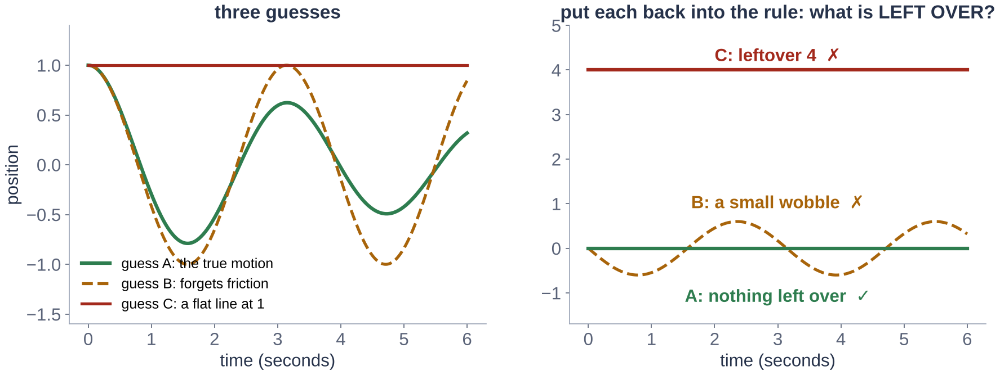
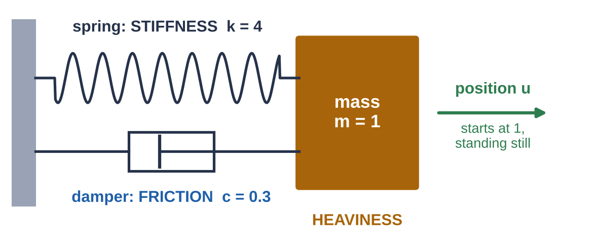
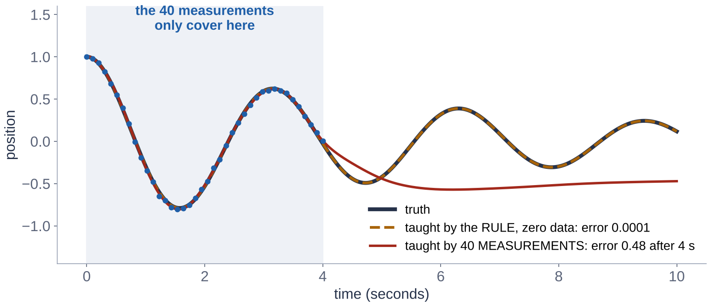
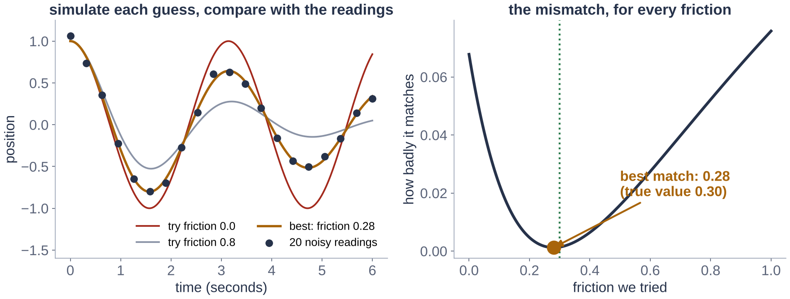

# Exercise 7 · Zero data: let the equation teach

*≈ 25 min · lecture Part 3, slides 34 to 48, and slide 62 · you build one line, then change one thing · electives E5 and E6*

## From the lecture

> **Key idea:** *With no measurements at all, a model can still learn. Put each guess back into the equation, and whatever
> is left over is the score: a physics-informed network (PINN, elective E6). Or use the equation as a simulator and make the
> data yourself: physics-informed machine learning (PIML, elective E5).*

> **The rule, in words:** heaviness × change of speed + friction × speed + stiffness × position = 0
>
> **The leftover:** m · u″ + c · u′ + k · u
>
> **With numbers:** a flat line at 1 leaves 4 over; the true motion leaves 0




## In plain words

Put the guess back into the spring’s rule: **heaviness × change of speed + friction × speed + stiffness × position**. Zero means the guess obeys. The check: a flat line at 1 has u = 1, u′ = 0, u″ = 0, so the leftover is 1 × 0 + 0.3 × 0 + 4 × 1 = **4**: it does not obey. No measurement appears anywhere: the equation is the teacher.



## Build: `my_leftover`

`u` is the guess (position), `du` its speed and `ddu` how fast the speed changes. The computer works out `du` and `ddu`
for you: you never solve the equation.

```python
def my_leftover(u, du, ddu, m, c, k):
    return None      # <- replace None with your one line

ls.check_my_leftover(my_leftover)
```

## Predict first

- **7b.** Network A sees **zero measurements** but is taught by the rule at 200 checkpoints. Network B (the same size) is
  fitted to **40 real measurements** from the first 4 seconds. Which predicts the spring better after 4 seconds?

## Run

```python
ls.zero_data(my_leftover)
```

## Look at

**Printout J**.



## Explain

- **7c.** How can a network with zero data beat one with 40 measurements beyond them?

## Change one thing: the two quiet failures

- **7d.** Predict, then run each cell. (i) Only 10 checkpoints: will the score be bigger or smaller, and the real error?
  (ii) The start is *not* built in: what might the network learn instead? Explain both results.

```python
ls.zero_data(my_leftover, checkpoints=10)
ls.zero_data(my_leftover, start_built_in=False)
```

## Physics-informed ML: find the unknown number

- **7e.** The equation is known, but the friction is not. Using only the simulator and 20 noisy readings, how close can we get to
  the true friction (0.3)? Predict, run, record **Printout K**, and say what this means for elective E5.

```python
ls.find_friction()
```


