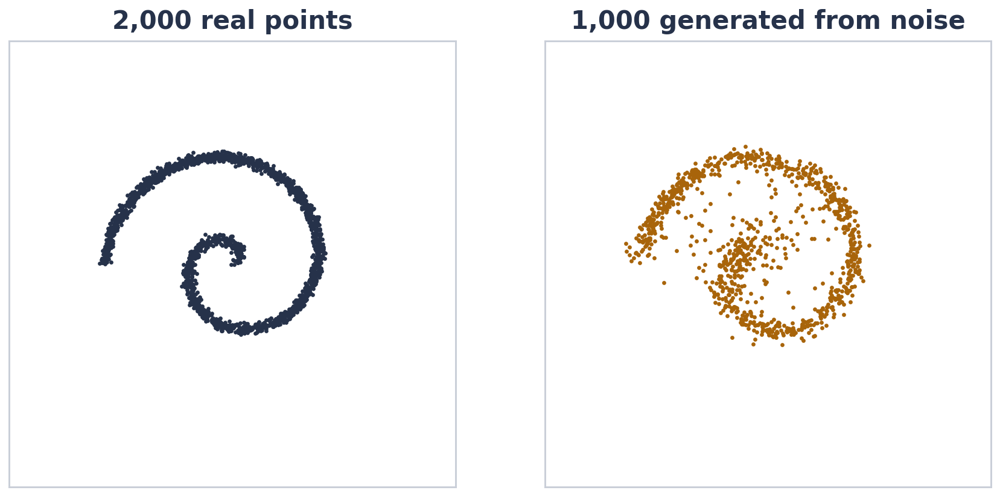

# Exercise 3 · Generate from pure noise

**3a · prediction.** **In between, close to the spiral** (0.097).

**3b · record and explain.** Table C: pure noise 0.419; generated 0.097; real points 0.031. Table D: generated → nearest
training point 0.056; training → nearest other training point 0.014; 5.8% of generated points sit within 0.005 of a training
point. The points walked from noise onto the spiral. They are a little blurrier than the real data, and mostly new: their nearest
training point is four times further away than real points are from each other. But a few are near-copies.

**3c · explain.** A model that copies its training data can leak it: a generator trained on private photos or medical records
could reproduce someone's photo or record. Checking how close outputs sit to the training data is part of auditing a generator.
