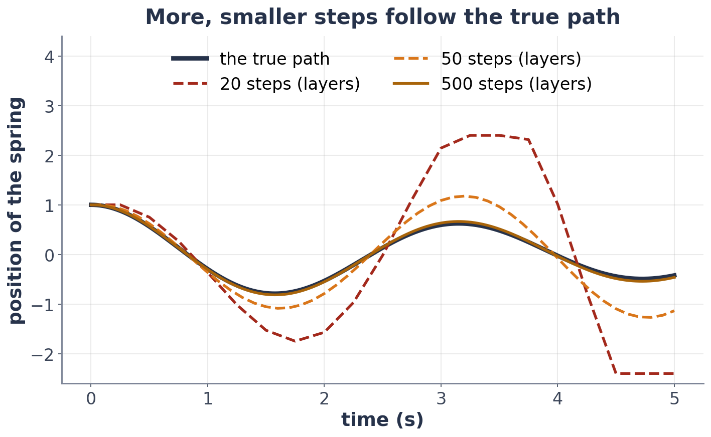

# Exercise 5 · Layers as steps; learn the rule of motion

**5a · build.** `return h + dt * f(h)`

**5b · prediction.** **500 small steps, by far:** off by 0.064 against 4.600, about 70 times closer.

| steps | end point off by |
|---|---|
| 20 | 4.600 |
| 50 | 0.882 |
| 100 | 0.374 |
| 500 | 0.064 |

**5c · prediction.** **The learned rule.**
*The tempting answer:* the curve, because it fits the observed points almost perfectly.

**5d · record and explain.** True rule [[0, 1], [−4, −0.3]]; learned [[−0.01, 1.00], [−3.95, −0.29]]. Average error after 5 s:
learned rule 0.021; fitted curve about 53,350. The curve only knows the shape of the 5 seconds it saw, and a polynomial shoots
off as soon as it leaves them. The rule says *how the spring moves at every moment*, which stays true after 5 seconds. E5 and E6
are built on this: learn (or impose) the rule of motion, and the model keeps working outside its training range.

**5e · change one thing.** **Worse: about 24 times** beyond 5 seconds (0.490 against 0.021).
*The tempting answer:* about the same, because friction is small, or better, because a rule built in by hand should be
cleaner than one learned from noisy data. Without friction the model's spring bounces for ever at full height, while the
real one slowly settles. The predictions look perfectly smooth and regular, so nothing in them warns you: you only see the
error by checking against reality. A wrong borrowing is worse than none, and it does not announce itself.
