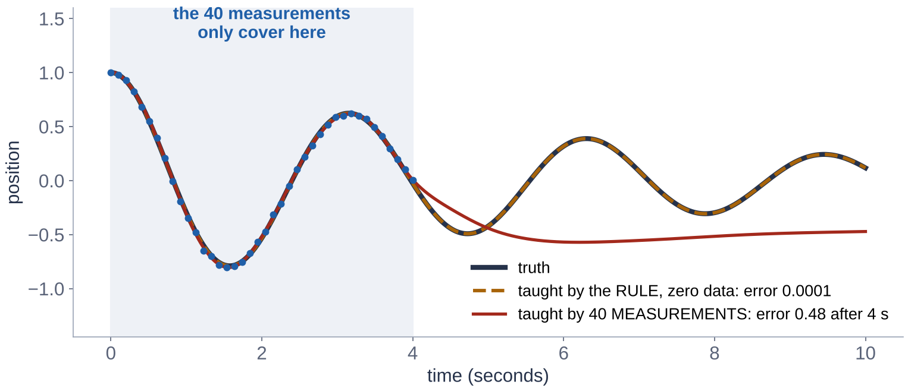

# Exercise 7 · Zero data: let the equation teach

**7a · build.** `return m * ddu + c * du + k * u`

**7b · prediction.** **Zero measurements wins, by far** after 4 s: 0.0001 against 0.48.
*The tempting answer:* the network with 40 real measurements, because data always beats no data.

**7c · record and explain.** Printout J: score about 5 × 10⁻⁸; real error 0.0001 over 10 s and after 4 s. The network fitted to 40
measurements: 0.48 after 4 s. The rule is true everywhere, including after 4 seconds; the measurements exist only where they
were taken. Data tells you about where it was collected; a trusted rule tells you about everywhere.

**7d · change one thing.** (i) **10 checkpoints:** the score is even smaller (about 10⁻²⁶, practically zero) but the real error
jumps to 0.31. The network obeys the rule perfectly at 10 moments and does whatever it likes in between: a tiny score only speaks
for the places checked. (ii) **Start not built in:** the score is exactly 0 and the error 0.33. The network learned "never move":
0 + 0 + 0 = 0 obeys the rule perfectly. The rule alone does not choose the motion; the start does, which is why it is built into
the answer (start + t² × network).
*The tempting answers:* fewer checkpoints means a worse score; and a network taught the rule will find the right motion on its own.

**7e · physics-informed ML.** Printout K: **0.28** from these 20 readings; over 30 repeats, 95% between 0.28 and 0.32 (true 0.30).
With a trusted equation, a simulator and a handful of noisy readings, you can recover an unknown setting closely. That is the
heart of elective E5: the equations make the data, and the readings only have to pin down what is missing.
